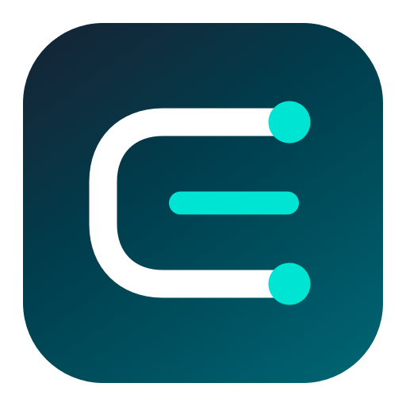
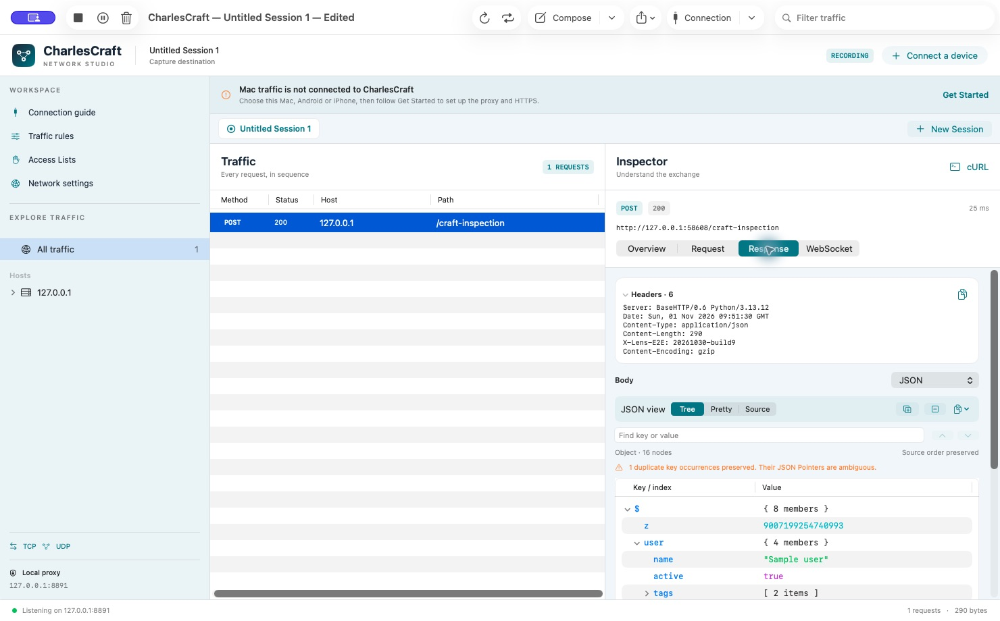
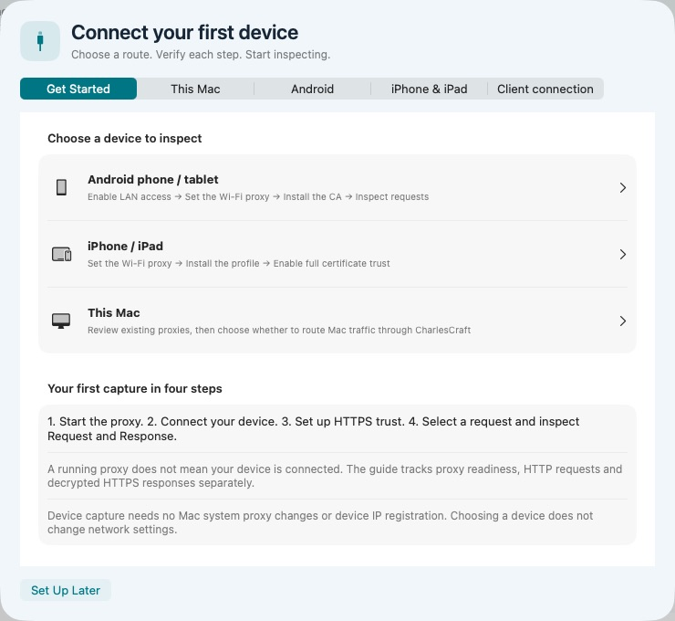

<p align="center"></p>
<h1 align="center">CharlesCraft</h1>
<p align="center"><strong>See the request. Understand the response.</strong><br>A native macOS HTTP &amp; HTTPS debugging proxy, built with SwiftUI and mitmproxy.</p>
<p align="center">
<a href="https://github.com/CauT/CharlesCraft/releases"></a>
<a href="https://github.com/CauT/CharlesCraft/actions/workflows/ci.yml"></a>
<a href="LICENSE"></a>

</p>
<p align="center"><a href="https://github.com/CauT/CharlesCraft/releases">Download</a> · <a href="docs/guide/usage.md">User guide</a> · <a href="CONTRIBUTING.md">Contribute</a></p>


CharlesCraft brings request inspection, traffic editing and phone debugging into a Mac
workspace. Inspect headers and bodies, pause a request, change its destination,
replay it, and save sessions for later. Processing runs locally, with no account
or hosted capture service. The interface is in English by default. The published
Mac build targets Apple Silicon (arm64), macOS 14 or later. Review sensitive
traffic before sharing any exports.

The 0.3.0 Craft redesign introduces a persistent workspace sidebar, a focused
capture header, clearer traffic and inspector panes, and a consistent visual
language across setup, settings, rules and request editors. The original code,
local storage and capture capabilities are retained. Existing Lens workspaces
and settings remain compatible; the internal bundle ID and data directory are
unchanged so this is an upgrade, not a separate empty profile.

Release notes identify the signing, notarization and actual acceptance status of
each downloadable artifact. Older Lens preview downloads remain historical
builds; they do not contain the Craft redesign. See the [verification scope](docs/guide/verification.md).





These are actual 0.3.0 windows with synthetic loopback traffic. See the
[current preview acceptance](docs/guide/craft-preview-acceptance.md).

## Features

| Workflow | Included |
| --- | --- |
| Inspect | HTTP/HTTPS, host/path navigation, search, separate Request and Response panes |
| Read bodies | Text, JSON, XML, hex, forms, multipart, WebSocket messages, schema-free Protobuf |
| Change traffic | Rewrite, Map Local/Remote, DNS mapping, URL Block/Allow Lists, editable breakpoints |
| Reproduce | Compose, Replay, Repeat and retained results |
| Manage sessions | Multiple sessions, workspace save/open, HAR import/export, body/CSV export |
| Debug devices | Android and iPhone/iPad guide, opt-in LAN proxy, public CA download |
| Shape connections | Bandwidth limits, loopback SOCKS/reverse proxy, TCP/UDP forwarding tools |

CharlesCraft is an independent application inspired by the workflow of Charles Proxy, and is not affiliated with or endorsed by its makers. It includes original
application code and open-source mitmproxy, with no Charles code, artwork or
certificates. It does not claim complete Charles compatibility.

JSON inspection includes a collapsible tree, syntax-colored Pretty view, original
Source, key/value search and exact value/JSON Pointer copying. It retains source
order, duplicate members and large integer spelling. [JSON reading guide](docs/guide/json-viewer.md).

## Quick start

1. Get the DMG from [Releases](https://github.com/CauT/CharlesCraft/releases).
   Check its signing status and SHA-256. Open it, drag **CharlesCraft.app → Applications**,
   eject the image, then open CharlesCraft.
2. Open **Connection → Get Started** and choose Mac, Android or iPhone/iPad.
3. Start with HTTP. For Mac traffic, review the active network service and
   explicitly choose **Use CharlesCraft for this service**, or configure one client.
   Starting a listener alone does not route ordinary browser traffic.
4. For HTTPS, install and trust **this copy's public CA** on the client, and
   include the target in **SSL hosts**. Inspect both Request and Response bodies.
5. Stop/Quit when finished. CharlesCraft restores proxy settings it still owns; turn a
   phone's Wi-Fi proxy off manually.

Already use Clash or a VPN? Review the existing route before replacing it.
An explicit HTTP upstream can be configured under **Network → HTTP upstream
proxy**. Phone capture does not require taking over the Mac system route.
[Full walkthrough and troubleshooting](docs/guide/usage.md).

### Android in five steps

1. Put the phone and Mac on the same reachable network.
2. In **Connection → Android**, stop if needed, enable LAN access, select the
   Mac LAN IPv4 and port, then save/start. No phone allowlist is required.
3. Set the phone's Wi-Fi manual proxy to that address and port, without `http://`.
4. Open **`http://lens.invalid/`**, compare its CA fingerprint with CharlesCraft, then
   download and install it as an Android **CA certificate**.
5. Open an HTTPS page and inspect its Request and Response in CharlesCraft.

The HTTP page does not prove HTTPS trust. Android's installed-CA monitoring
notice differs from a browser-blocking certificate error. Modern apps may reject
user CAs or pin certificates; CharlesCraft does not bypass that protection.
LAN starts disabled on every app launch. All devices able to reach an enabled
LAN address can connect.


## Build from source

Requires macOS 14+, Apple's Command Line Tools and an existing
[uv](https://docs.astral.sh/uv/) installation. Full Xcode is not required.
Bootstrap downloads the pinned private Python runtime and locked dependencies
inside the checkout; the app bundles them for use outside the checkout.

```sh
git clone https://github.com/CauT/CharlesCraft.git
cd CharlesCraft
bash scripts/bootstrap.sh
bash scripts/build-app.sh
open CharlesCraft.app
```

Local builds use ad-hoc signing. See [development/tests](docs/guide/development.md)
and [DMG/release packaging](docs/guide/releasing.md).

## Current boundaries

- Proxy-aware clients only: this is not a VPN or a claim to capture every app.
- HTTPS needs trust and matching host scope; pinned apps can refuse it.
- No HTTP/3 decoding, AMF, schema-aware gRPC/Protobuf or Charles private sessions.
- Capture retention and previews are bounded; see [storage limits](docs/guide/usage.md#limits-and-storage).
- This release's UI capture check uses a controlled client with an explicit proxy.
  Ordinary Mac traffic through system routing and physical Android/iOS acceptance
  remain unverified in this release run. Existing host proxy/VPN settings and
  certificate trust were unchanged. Read the release's actual acceptance notes.

## Contributing and license

Bug reports with reproducible steps and sanitized evidence are welcome.
Read [CONTRIBUTING](CONTRIBUTING.md) and [SECURITY](SECURITY.md). Never upload
private CA keys, credentials or unreviewed captures. Star the project if it helps.

[MIT](LICENSE). Thanks to [mitmproxy](https://mitmproxy.org/),
[CPython](https://www.python.org/) and
[python-build-standalone](https://github.com/astral-sh/python-build-standalone).
Original copyright notices are retained; dependencies retain their own licenses.
See [third-party notices](THIRD_PARTY_NOTICES.md).
